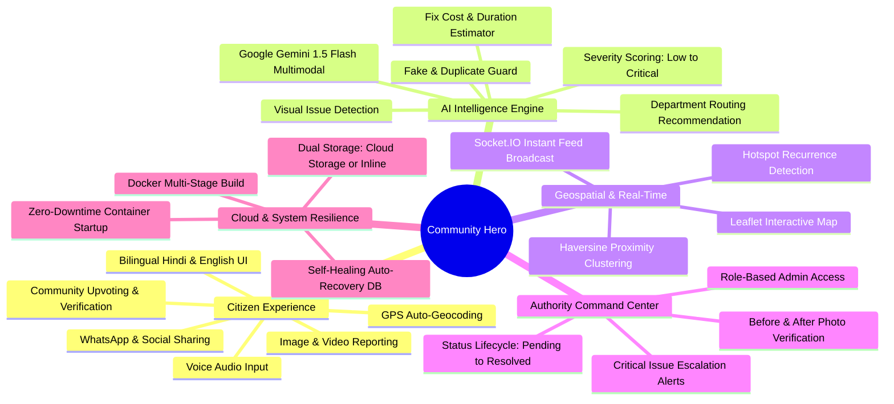
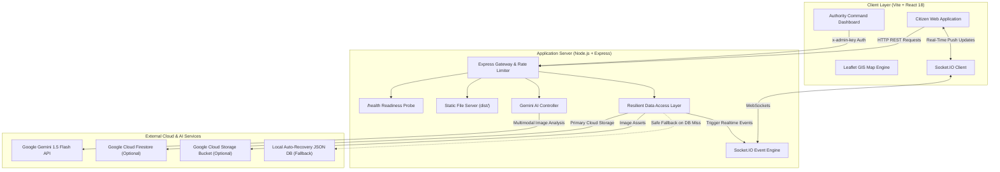
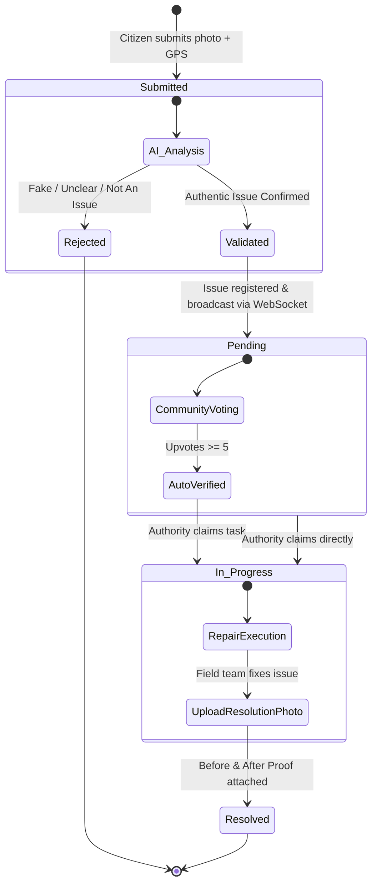
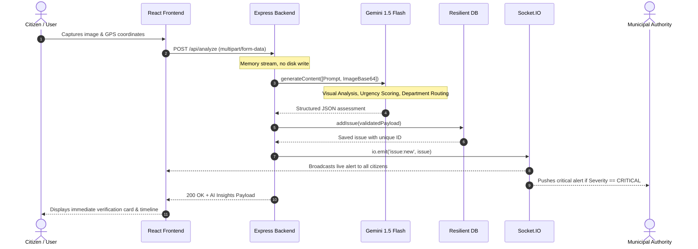
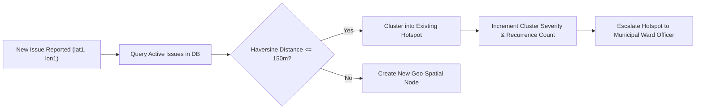

# 🛡️ Community Hero

> **AI-Powered Hyperlocal Civic Infrastructure Reporting & Resolution Platform**  
> Empowering citizens and local authorities to detect, verify, map, and resolve community infrastructure challenges using Google Gemini AI, real-time WebSockets, and geospatial intelligence.

[](https://community-hero-oxtx.onrender.com)
[](https://community-hero-oxtx.onrender.com/health)
[](https://ai.google.dev/)
[](https://react.dev)

---

## 🌐 Live Deployments

- **Live Application (Frontend & Backend)**: [https://community-hero-oxtx.onrender.com](https://community-hero-oxtx.onrender.com)
- **Service Health Check**: [https://community-hero-oxtx.onrender.com/health](https://community-hero-oxtx.onrender.com/health)
- **GitHub Repository**: [https://github.com/Anu7276/community-hero](https://github.com/Anu7276/community-hero)

---

## 🧠 Platform Mind Map

The mind map below illustrates the end-to-end ecosystem of Community Hero across its core operational pillars:



---

## 🏛️ System Architecture

Community Hero is packaged as a production-hardened full-stack application. A single high-performance Docker container serves the optimized React 18 client alongside the Express API and Socket.IO engine.



---

## 🔄 Issue Lifecycle & State Machine

Every report progresses through an automated pipeline from citizen capture to field verification and civic resolution:



---

## ⚡ AI Analysis & Reporting Sequence

When a citizen snaps an infrastructure defect, the multimodal Gemini pipeline inspects the image within seconds:



---

## 🧩 Hotspot & Clustering Logic

To identify chronic systemic failures (e.g. repeated road craters or pipe bursts), Community Hero employs the **Haversine Geodetic Formula**:



$$\text{distance} = 2R \cdot \arcsin\left(\sqrt{\sin^2\left(\frac{\Delta \varphi}{2}\right) + \cos(\varphi_1)\cos(\varphi_2)\sin^2\left(\frac{\Delta \lambda}{2}\right)}\right)$$

---

## 🧰 Technology Matrix

| Layer | Technologies | Purpose |
| :--- | :--- | :--- |
| **Frontend** | React 18, Vite, Tailwind CSS, Lucide Icons | Responsive mobile-first citizen UI, glassmorphic status badges |
| **Maps & GIS** | Leaflet, React-Leaflet, Google Maps Embed API | Geospatial visualization, clustering, interactive markers |
| **Backend** | Node.js, Express.js | High-throughput REST API, rate limiting, multipart handling |
| **Real-Time** | Socket.IO | Instant feed updates, live upvoting counter, authority alerts |
| **Artificial Intelligence** | Google Gemini 1.5 Flash (`@google/generative-ai`) | Multimodal vision analysis, severity scoring, fraud detection |
| **Persistence** | Auto-Recovery Local JSON / Firestore | Resilient hybrid database with automatic fallback recovery |
| **Media Storage** | Cloud Storage / Data URI Fallback | Dual image hosting mode ensuring 100% upload success |
| **Containerization** | Docker (Alpine Node 20) | Multi-stage production build packaging client and server |
| **Hosting** | Render / Google Cloud Run | Zero-configuration cloud hosting with automated SSL |

---

## 📂 Project Directory Structure

```text
community-hero/
├── backend/
│   ├── controllers/
│   │   └── geminiController.js   # Multimodal prompt & Gemini model client
│   ├── db/
│   │   └── init.js               # Dual-mode resilient database (Firestore + JSON)
│   ├── routes/
│   │   ├── analyze.js            # Image upload, rate limiting & AI workflow
│   │   └── issues.js             # CRUD, voting, comments, hotspots & authority stats
│   ├── package.json              # Backend dependencies & scripts
│   └── server.js                 # Express server, Socket.IO, static asset host
├── frontend/
│   ├── src/
│   │   ├── components/           # Navbar, BottomNav, Map, Timeline, LiveUpdates
│   │   ├── hooks/                # useGeolocation, useSocket, useVoice, useLanguage
│   │   ├── pages/                # Dashboard, ReportIssue, MapView, IssueDetail, Authority
│   │   ├── utils/                # api.js, reverseGeocode.js, formatDate.js
│   │   ├── App.jsx               # Client routes & error boundaries
│   │   └── main.jsx              # React DOM initialization
│   ├── vercel.json               # SPA routing rewrite configuration
│   ├── vite.config.js            # Vite build configuration & dev proxy
│   └── package.json              # Frontend dependencies
├── Dockerfile                    # Multi-stage production container definition
├── package.json                  # Root monorepo orchestrator
└── README.md                     # Architecture documentation
```

---

## 📡 API Reference

### Health & System
| Method | Endpoint | Description |
| :--- | :--- | :--- |
| `GET` | `/health` | Container liveness and readiness probe |
| `GET` | `/` | Web application root (serves React SPA) |

### AI Analysis & Reporting
| Method | Endpoint | Payload / Headers | Description |
| :--- | :--- | :--- | :--- |
| `POST` | `/api/analyze` | `multipart/form-data` (`image`, `userContext`, `userLat`, `userLng`) | Executes Gemini multimodal audit, registers issue, emits WebSocket event |

### Civic Issues
| Method | Endpoint | Description |
| :--- | :--- | :--- |
| `GET` | `/api/issues` | Retrieve all issues (supports filtering by `status`, `category`) |
| `GET` | `/api/issues/:id` | Fetch single issue details, timeline, and comments |
| `POST` | `/api/issues/:id/vote` | Cast an upvote or downvote with session deduplication |
| `PATCH` | `/api/issues/:id/status` | Update issue state (`x-admin-key` header required) |
| `POST` | `/api/issues/:id/resolve-photo` | Attach resolved verification photo and mark completed |
| `GET` | `/api/issues/meta/hotspots` | Fetch Haversine proximity clusters and repeat problem zones |
| `GET` | `/api/issues/meta/stats` | Aggregate civic health metrics, resolution rate, and reporter rank |

---

## 🚀 Local Development Setup

### 1. Prerequisites
- **Node.js**: v18.0.0 or higher
- **Google AI Studio API Key**: [Get a Gemini API Key](https://aistudio.google.com/)

### 2. Clone and Install
```bash
git clone https://github.com/Anu7276/community-hero.git
cd community-hero
npm run install:all
```

### 3. Environment Setup

Create `backend/.env`:
```env
PORT=5000
NODE_ENV=development
GEMINI_API_KEY=your_gemini_api_key_here
GEMINI_MODEL=gemini-1.5-flash
ADMIN_KEY=community-hero-admin
FRONTEND_URL=http://localhost:5173
DB_PROVIDER=local
```

Create `frontend/.env`:
```env
VITE_API_URL=http://localhost:5000
VITE_GOOGLE_MAPS_KEY=your_optional_maps_key
```

### 4. Launch Development Servers
```bash
npm run dev
```

- **Frontend Application**: `http://localhost:5173`
- **Backend API**: `http://localhost:5000`
- **Health Check**: `http://localhost:5000/health`

---

## 🐳 Production Deployment

### Option A: Render (Zero Configuration — Recommended)
1. Fork or push this repository to GitHub.
2. Create a new **Web Service** on [Render](https://render.com).
3. Connect your repository.
4. Select Environment: **Docker**.
5. Add environment variable: `GEMINI_API_KEY` = your API key.
6. Render builds the multi-stage Docker image and deploys instantly!

### Option B: Google Cloud Run
Deploy directly from source using the Google Cloud CLI:

```bash
gcloud run deploy community-hero \
  --source . \
  --region asia-south1 \
  --allow-unauthenticated \
  --port 8080 \
  --set-env-vars NODE_ENV=production,GEMINI_MODEL=gemini-1.5-flash
```

---

## 🔒 Security & Resilience Features

- **Port Fast-Binding**: Express binds to `$PORT` immediately upon boot, eliminating 503 container startup drops.
- **Fail-Safe Storage**: Automatic fallback to local in-memory/JSON storage if cloud credentials or Firestore are missing.
- **Rate Limiting**: Built-in 15-second IP cooldown preventing Gemini API quota exhaustion.
- **Role-Based Admin Protection**: Authority status changes secured via `x-admin-key` validation.
- **Sanitized Media Handling**: Strictly validated MIME types and in-memory buffer processing without disk vulnerabilities.

---

## 📄 License

This project is licensed under the **MIT License**. See the [LICENSE](LICENSE) file for details.
